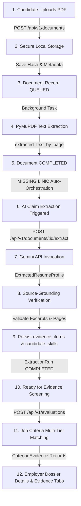

# ClearHire — AI Document Extraction & Evidence Screening Audit

**Audit Date**: November 1, 2026  
**Auditor**: Antigravity Autonomous Agent  
**Scope**: Full End-to-End Pipeline (Candidate Upload → Text Extraction → AI Claim Extraction → Source-Grounding Validation → Evidence Screening → Employer Dossier)

---

## Executive Summary

ClearHire's employer review workflow relies on automated resume parsing, structured claim extraction, source-grounding verification, and criteria-to-evidence matching. While low-level primitives (PyMuPDF text extraction, Gemini LLM provider, and criteria ranking algorithms) exist in the codebase, the end-to-end integration suffers from four critical lifecycle breakdowns:
1. **Pipeline Decoupling**: Document upload text extraction terminates without initiating AI claim extraction. Resumes sit in text-extracted state indefinitely unless manually invoked.
2. **Frontend Polling & Timeout Prematurity**: The frontend claim extraction poller times out after only 15 seconds (10 attempts × 1.5s) while real Gemini API round-trips require 15–25 seconds.
3. **Application vs. Evaluation ID Query Mismatch**: `EmployerApplicationDetailPage` queries `GET /api/v1/evaluations/{app.id}`, passing an Application UUID to an endpoint expecting an Evaluation UUID. On every page refresh or applicant switch, the frontend receives HTTP 404 and resets to "Screening Evaluation Pending".
4. **Silent Prerequisite Failure**: When screening evaluation is triggered on an application whose document lacks completed claims, the backend raises HTTP 422, which was caught silently in component state without user explanation or recovery paths.

---

## 1. Lifecycle State Machine & Traceability Matrix

---

## 2. Detailed Stage-by-Stage Trace

### Stage 1: Candidate Uploads PDF
- **Input**: Multipart form data with `.pdf` binary, candidate JWT auth token.
- **Output**: `DocumentUploadResponse` (`id`, `file_name`, `file_hash`, `file_size_bytes`, `processing_status="queued"`).
- **Responsible File & Function**: `backend/app/api/v1/endpoints/documents.py` (`upload_document`) & `backend/app/services/document.py` (`create_and_store_document`).
- **Endpoint**: `POST /api/v1/documents`
- **Database Model**: `documents` table (`Document`).
- **Status Transition**: None → `QUEUED`.
- **Status**: **Working**. Magic bytes (`%PDF-`), file size limits, and SHA-256 computation operate as intended.

### Stage 2: File Stored in Secure Storage
- **Input**: Raw bytes, sanitized filename, document UUID.
- **Output**: Filesystem path: `/home/vanilla/Desktop/hackathon/sap/backend/storage/documents/{doc_id}.pdf`.
- **Responsible File & Function**: `backend/app/services/storage.py` (`LocalStorageService.save_file`).
- **Status**: **Working**. Secure path isolation prevents path traversal.

### Stage 3: Database Record Created in `documents` Table
- **Input**: Extracted file metadata, candidate ID.
- **Output**: Persisted `Document` row with empty `extracted_text_by_page={}` and status `QUEUED`.
- **Responsible File & Function**: `backend/app/services/document.py` (`create_and_store_document`).
- **Status**: **Working**.

### Stage 4: Document Text Extraction Starts
- **Input**: Document UUID.
- **Output**: Background task execution in fresh DB session.
- **Responsible File & Function**: `backend/app/services/document.py` (`DocumentService.process_document_extraction`).
- **Status Transition**: `QUEUED` → `PROCESSING`.
- **Status**: **Working**. Concurrency lock `_active_doc_ids` prevents duplicate worker execution.

### Stage 5: Extracted Text Stored in `extracted_text_by_page`
- **Input**: PDF file path on disk.
- **Output**: Dictionary mapping string page numbers (`"1"`, `"2"`) to page text strings, `page_count` integer.
- **Responsible File & Function**: `backend/app/utils/document.py` (`extract_text_by_page`).
- **Database Model**: `Document.extracted_text_by_page`, `Document.page_count`.
- **Status Transition**: `PROCESSING` → `COMPLETED` (or `FAILED` if corrupt / encrypted / scanned image requiring OCR).
- **Status**: **Working**. Scanned PDFs correctly raise `OCRRequiredError`.

### Stage 6: AI Claim Extraction Triggered
- **Input**: Document ID with status `COMPLETED` and non-empty `extracted_text_by_page`.
- **Output**: Enqueued background task for `AIExtractionService.extract_and_persist`.
- **Responsible File & Function**: `backend/app/api/v1/endpoints/documents.py` (`trigger_ai_extraction`).
- **Endpoint**: `POST /api/v1/documents/{document_id}/extract`.
- **Database Model**: `extraction_runs` table (`ExtractionRun`).
- **Status Transition**: None → `QUEUED` → `PROCESSING`.
- **Defect / Root Cause**:
  - **Auto-orchestration missing**: `DocumentService.process_document_extraction` did not trigger claim extraction upon text extraction completion.
  - **No document-level concurrency lock**: If multiple calls hit `extract_and_persist(doc_id)` concurrently without `run_id`, duplicate extraction runs were initiated.

### Stage 7: AI API Called with Extracted Text
- **Input**: Page-indexed resume text dictionary, document hash.
- **Output**: Pydantic `ExtractedResumeProfile` with structured fields and source quotes.
- **Responsible File & Function**: `backend/app/integrations/llm/client.py` (`HTTPClientLLMProvider.extract_resume_profile`).
- **Provider / Model**: Google Gemini via OpenAI-compatible endpoint (`gemini-3.5-flash-lite`).
- **Defect / Root Cause**:
  - In sandboxed environments without outbound networking, HTTPS requests to `generativelanguage.googleapis.com` fail with `[Errno -2] Name or service not known`. Outbound internet access must be permitted.

### Stage 8: Structured Claims Extracted
- **Input**: LLM raw JSON output conforming to `ExtractedResumeProfile`.
- **Output**: Structured collections of skills, work experiences, education credentials, projects, certifications, and candidate header info.
- **Responsible File & Function**: `backend/app/integrations/llm/schemas.py` & `backend/app/services/extraction.py`.
- **Defect / Root Cause**:
  - `ExtractionRunResponse` schema and endpoints dropped `raw_output` and candidate contact details, preventing the frontend from displaying name, email, and summaries from the extraction run.

### Stage 9: Grounding Verified Against Original Text and Page Numbers
- **Input**: Each claim's `source_quote.exact_excerpt` and `source_quote.page_number`.
- **Output**: Boolean `is_grounded`. If ungrounded: `confidence = 0.0`, `grounding_verified = False`, and `raw_metadata["grounding_failure"]` set.
- **Responsible File & Function**: `backend/app/utils/text.py` (`validate_excerpt_in_text`) and `backend/app/services/extraction.py`.
- **Status**: **Working**. Normalized token sliding-window matching strictly rejects hallucinations or fabricated citations without altering original excerpts.

### Stage 10: Claims Stored in `evidence_items` and `candidate_skills` Tables
- **Input**: Grounded evidence items and skills.
- **Output**: Persisted rows linked to `extraction_run_id` and `document_id`.
- **Responsible File & Function**: `backend/app/repositories/domain.py` (`ExtractionRepository`).
- **Database Models**: `evidence_items`, `candidate_skills`, `extraction_runs`.
- **Status Transition**: `ExtractionRun.status`: `PROCESSING` → `COMPLETED`.
- **Status**: **Working**. Atomic database commits persist artifacts with rollback on error.

### Stage 11: Evidence Screening Evaluated Against Job Criteria
- **Input**: `application_id`.
- **Output**: Versioned `Evaluation` record with factual coverage counts and `CriterionEvidence` items.
- **Responsible File & Function**: `backend/app/services/evaluation.py` (`EvaluationService.evaluate_application`).
- **Endpoint**: `POST /api/v1/evaluations`.
- **Database Models**: `evaluations`, `criterion_evidence`, `audit_events`.
- **Defect / Root Cause**:
  - Requires `extraction_run.status == COMPLETED`. If claim extraction was missing, threw HTTP 422 with zero UI guidance.
  - No concurrency lock on `application_id`, allowing concurrent duplicate evaluations.
  - Missing endpoint to query evaluation by `application_id` (`GET /api/v1/evaluations/application/{application_id}`).

### Stage 12: Results Displayed in Employer Dossier (Details and Evidence Tabs)
- **Input**: Dossier active applicant record.
- **Output**: Interactive PDF viewer, grounded claims profile, criteria coverage summary, and adjudication cards.
- **Responsible File & Function**:
  - `frontend/src/pages/employer/EmployerApplicationDetailPage.tsx`
  - `frontend/src/components/dossier/CandidateExtractedProfile.tsx`
  - `frontend/src/components/evidence/CoverageSummaryBar.tsx`
  - `frontend/src/components/evidence/CriterionEvidenceCard.tsx`
- **Defect / Root Cause**:
  - `EmployerApplicationDetailPage` tried `evaluationService.getEvaluation(app.id)`, failing with 404 on every page reload or tab change.
  - Polling in `CandidateExtractedProfile.tsx` timed out after 15s instead of allowing 45s for Gemini AI inference.
  - Error messages from failed extractions were not surfaced in the UI.

---

## 3. Remediation Actions

1. **Document Service**: Auto-trigger `AIExtractionService().extract_and_persist(doc_id)` upon successful text extraction in `process_document_extraction`.
2. **Extraction Service**: Add document-level concurrency lock `_active_doc_ids` to eliminate race conditions and redundant extraction runs.
3. **API Schemas**: Expose `raw_output` in `ExtractionRunResponse`.
4. **Document Endpoints**: Populate `raw_output` in extraction results.
5. **Evaluation Repo**: Add `get_latest_by_application(app_id)` to `EvaluationRepository`.
6. **Evaluation Endpoints**: Add `GET /api/v1/evaluations/application/{application_id}` with strict tenant authorization.
7. **Evaluation Service (FE)**: Add `getEvaluationByApplication(applicationId)` calling the new endpoint.
8. **Candidate Profile (FE)**: Extend polling to 45s, support live status updates, display failure errors, auto-poll on mount.
9. **Employer Dossier (FE)**: Use `getEvaluationByApplication`, add prerequisite handling with clear UI alert and one-click extraction.
