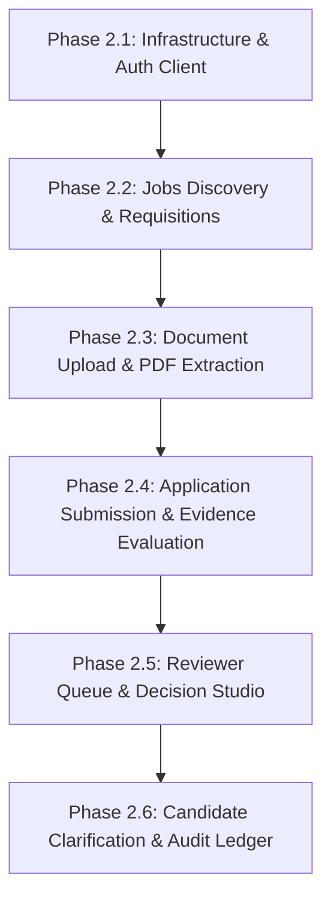

# ClearHire — Backend–Frontend API Integration Map (Phase 1 Audit)

> **Document Status:** Complete & Authoritative  
> **Backend Source Audited:** `/home/vanilla/Desktop/hackathon/sap/backend` (FastAPI / SQLAlchemy / Pydantic)  
> **Frontend Source Audited:** `/home/vanilla/Desktop/hackathon/sap/frontend` (React 18 / TypeScript / Vite)  
> **Backend Base URL:** `http://localhost:8000/api/v1`  
> **OpenAPI Specification URL:** `http://localhost:8000/openapi.json`  
> **Date of Audit:** November 1, 2026  

---

## 1. Executive Summary & Audit Scope

This audit maps the existing ClearHire FastAPI backend to the 14 active routes of the React frontend MVP. The objective is to establish exact API contracts, identify workflow dependencies, document hardcoded values and mock replacements, and identify contract discrepancies prior to connecting network calls.

### Non-Negotiable Integration Rules Enforced
1. **Backend is strictly READ-ONLY**: No backend endpoints, schemas, or models have been altered.
2. **Preserve Frontend Design & 14-Route MVP**: Design system tokens (`#171A19` canvas, `#222625` surface, `#C8FFF5` mint, Manrope typography) and route structure remain untouched.
3. **No Inventions**: Every endpoint, parameter, and header listed reflects actual backend code.
4. **Classification Key**:
   - `READY`: Backend endpoint exists, schema is verified, and contract is understood.
   - `BLOCKED`: Endpoint, required field, or mandatory behavior is missing from the backend.
   - `UNCERTAIN`: Ambiguity in source implementation requires multi-call client orchestration.

---

## 2. Complete Backend API Endpoint Inventory

| # | HTTP Method | Endpoint Path | Tag / Domain | Auth Required | Authorized Roles | Request Contract | Response Contract | Status |
| :--- | :--- | :--- | :--- | :--- | :--- | :--- | :--- | :--- |
| **1** | `POST` | `/api/v1/auth/register` | Authentication | Public | All (Assigns `candidate`) | `CandidateRegisterRequest` | `UserResponse` (201) | `READY` |
| **2** | `POST` | `/api/v1/auth/login` | Authentication | Public | All | `LoginRequest` | `TokenResponse` (200) | `READY` |
| **3** | `GET` | `/api/v1/auth/me` | Authentication | Bearer JWT | All authenticated | None | `UserResponse` (200) | `READY` |
| **4** | `POST` | `/api/v1/auth/provision` | Authentication | Bearer JWT | `employer_admin`, `system_auditor` | `AdminUserProvisionRequest` | `UserResponse` (201) | `READY` |
| **5** | `GET` | `/api/v1/health` | System Health | Public | All | None | `HealthResponse` (200) | `READY` |
| **6** | `GET` | `/api/v1/health/live` | System Health | Public | All | None | `LivenessResponse` (200) | `READY` |
| **7** | `GET` | `/api/v1/health/ready` | System Health | Public | All | None | `ReadinessResponse` (200 / 503) | `READY` |
| **8** | `GET` | `/api/v1/jobs` | Jobs & Criteria | Bearer JWT | `candidate` (active only), `employer_admin` (org-scoped), `reviewer` (org-scoped), `system_auditor` | Query: `status`, `department`, `limit`, `offset` | `list[JobResponse]` (200) | `READY` |
| **9** | `POST` | `/api/v1/jobs` | Jobs & Criteria | Bearer JWT | `employer_admin`, `reviewer` | `JobCreateRequest` | `JobResponse` (201) | `READY` |
| **10** | `GET` | `/api/v1/jobs/{id}` | Jobs & Criteria | Bearer JWT | All authenticated | Path: `id` (UUID) | `JobResponse` (200) | `READY` |
| **11** | `GET` | `/api/v1/applications` | Applications | Bearer JWT | `candidate` (own only), `employer_admin` (org only), `reviewer` (org only), `system_auditor` | Query: `job_id`, `status`, `limit`, `offset` | `list[ApplicationResponse]` (200) | `READY` |
| **12** | `POST` | `/api/v1/applications` | Applications | Bearer JWT | All (`candidate` can only apply with own doc) | `ApplicationCreateRequest` | `ApplicationResponse` (201) | `READY` |
| **13** | `GET` | `/api/v1/applications/{id}` | Applications | Bearer JWT | `candidate` (own only), `employer_admin` (org only), `reviewer` (org only), `system_auditor` | Path: `id` (UUID) | `ApplicationResponse` (200) | `READY` |
| **14** | `POST` | `/api/v1/documents` | Documents | Bearer JWT | All authenticated | `multipart/form-data` (`file: UploadFile`) | `DocumentUploadResponse` (202) | `READY` |
| **15** | `GET` | `/api/v1/documents/{document_id}/status` | Documents | Bearer JWT | Candidate (owner), Employer/Reviewer (org applicant), Auditor | Path: `document_id` (UUID) | `DocumentStatusResponse` (200) | `READY` |
| **16** | `POST` | `/api/v1/documents/{document_id}/retry` | Documents | Bearer JWT | Candidate (owner), Employer/Reviewer (org applicant) | Path: `document_id` (UUID) | `DocumentStatusResponse` (202) | `READY` |
| **17** | `POST` | `/api/v1/documents/{document_id}/extract` | Documents | Bearer JWT | Candidate (owner), Employer/Reviewer (org applicant) | Path: `document_id` (UUID) | `ExtractionRunResponse` (202) | `READY` |
| **18** | `GET` | `/api/v1/documents/{document_id}/extraction-results` | Documents | Bearer JWT | Candidate (owner), Employer/Reviewer (org applicant), Auditor | Path: `document_id` (UUID) | `ExtractionRunResponse` (200) | `READY` |
| **19** | `POST` | `/api/v1/evaluations` | Evaluations | Bearer JWT | `employer_admin`, `reviewer`, `system_auditor` | `EvaluationCreateRequest` (`application_id`) | `EvaluationResponse` (201) | `READY` |
| **20** | `GET` | `/api/v1/evaluations/{id}` | Evaluations | Bearer JWT | Candidate (own app), Employer/Reviewer (org app), Auditor | Path: `id` (UUID - Evaluation ID) | `EvaluationResponse` (200) | `READY` |
| **21** | `POST` | `/api/v1/review-flags` | Human Review | Bearer JWT | `employer_admin`, `reviewer` | `ReviewFlagCreateRequest` | `ReviewFlagBatchResponse` (201) | `READY` |
| **22** | `GET` | `/api/v1/review-flags` | Human Review | Bearer JWT | `reviewer` (assigned), `employer_admin` (org), `system_auditor` | Query: `status`, `application_id` | `list[ReviewFlagSummaryResponse]` (200) | `READY` |
| **23** | `GET` | `/api/v1/reviews/{id}` | Human Review | Bearer JWT | Reviewer (assigned), Employer (org), Candidate (own), Auditor | Path: `id` (UUID - Flag ID) | `ReviewCaseDetailResponse` (200) | `READY` |
| **24** | `POST` | `/api/v1/reviews/{id}/decision` | Human Review | Bearer JWT | `reviewer` (assigned), `employer_admin` (org) | `ReviewDecisionRequest` | `ReviewDecisionResponse` (201) | `READY` |
| **25** | `POST` | `/api/v1/applications/{id}/clarifications` | Human Review | Bearer JWT | `candidate` (own application only) | `CandidateClarificationRequest` | `CandidateClarificationResponse` (201) | `READY` |
| **26** | `POST` | `/api/v1/reviews/{id}/clarification` | Human Review | Bearer JWT | `candidate` (convenience by flag ID) | `CandidateClarificationRequest` | `CandidateClarificationResponse` (201) | `READY` |
| **27** | `GET` | `/api/v1/profiles/{id}/skills` | Profiles | Bearer JWT | Candidate (self), Employer/Reviewer (org applicant), Auditor | Path: `id` (UUID - Candidate ID) | `CandidateProfileSkillsResponse` (200) | `READY` |
| **28** | `GET` | `/api/v1/audit/verify` | Audit | Bearer JWT | `system_auditor`, `employer_admin` | None | `AuditVerificationReportResponse` (200) | `READY` |
| **29** | `GET` | `/api/v1/audit` | Audit | Bearer JWT | `system_auditor`, `employer_admin` (org-filtered) | Query: `resource_type`, `resource_id`, `actor_id`, `limit`, `offset` | `list[AuditEventDetailResponse]` (200) | `READY` |
| **30** | `GET` | `/api/v1/audit/{id}` | Audit | Bearer JWT | Auditor, Employer Admin, Reviewer (assigned), Candidate (own) | Path: `id` (UUID - Event ID) | `AuditEventDetailResponse` (200) | `READY` |
| **31** | `GET` | `/api/v1/integrations/successfactors/feed` | Integrations | Bearer JWT | All authenticated | None | `SFApplicantFeedBatch` (200) | `READY` |
| **32** | `POST` | `/api/v1/integrations/successfactors/import` | Integrations | Bearer JWT | `employer_admin`, `system_auditor` | `SFApplicantFeedBatch | None` | `SFImportResult` (200) | `READY` |
| **33** | `GET` | `/api/v1/benchmark/run` | Benchmark | Bearer JWT | All authenticated | None | `BenchmarkReport` (200) | `READY` |

---

## 3. Frontend Route to Backend API Mapping

### Public Routes (4 Routes)

#### 1. Landing Page (`/`)
- **Page Component:** `LandingPage.tsx`
- **Role:** Public (Unauthenticated)
- **Backend Endpoints:** None (Marketing presentation)
- **Actions:** "Log In" ➔ `/login`, "Register" ➔ `/register`
- **Integration Status:** `READY`

#### 2. Login Page (`/login`)
- **Page Component:** `LoginPage.tsx`
- **Role:** Public (Unauthenticated)
- **Backend Endpoints Required:**
  1. `POST /api/v1/auth/login`
     - Request: `{ "email": string, "password": string }`
     - Response: `{ "access_token": string, "token_type": "bearer", "expires_in": number }`
  2. `GET /api/v1/auth/me`
     - Header: `Authorization: Bearer <access_token>`
     - Response: `UserResponse` (`id`, `email`, `full_name`, `role`, `employer_id`)
- **Current Mock Implementation:**
  - Calls `mockService.login(email)`. Returns dummy token `mock-jwt-token-for-...`.
- **Integration Status:** `READY`

#### 3. Candidate Registration (`/register`)
- **Page Component:** `RegisterPage.tsx`
- **Role:** Public (Unauthenticated)
- **Backend Endpoints Required:**
  1. `POST /api/v1/auth/register`
     - Request: `{ "email": string, "password": string, "full_name": string }`
     - Response: `UserResponse` (201)
  2. `POST /api/v1/auth/login` (Auto-login post registration)
     - Request: `{ "email": string, "password": string }`
     - Response: `TokenResponse` (200)
- **Current Mock Implementation:**
  - Calls `mockService.login(email, UserRole.CANDIDATE)`.
- **Integration Status:** `READY`

#### 4. Access Denied (`/403`) & Not Found (`/404`)
- **Page Components:** `AccessDeniedPage.tsx`, `NotFoundPage.tsx`
- **Role:** Any
- **Backend Endpoints:**
  - Handled via client router on HTTP 403 / 404 responses from API client.
- **Integration Status:** `READY`

---

### Candidate Experience (5 Routes)

#### 5. Candidate Dashboard (`/candidate/dashboard`)
- **Page Component:** `CandidateDashboardPage.tsx`
- **Role:** `candidate`
- **Backend Endpoints Required:**
  1. `GET /api/v1/applications`
     - Response: `list[ApplicationResponse]` (candidate's submissions)
  2. `GET /api/v1/jobs?status=active&limit=3`
     - Response: `list[JobResponse]` (Featured active openings)
  3. `GET /api/v1/review-flags`
     - Response: `list[ReviewFlagSummaryResponse]` (Pending clarification flags for candidate)
  4. `GET /api/v1/audit?actor_id={user.id}&limit=4`
     - Response: `list[AuditEventDetailResponse]` (Recent ledger activity)
- **Current Mock Implementation:**
  - Calls `mockService.listApplications()`, `mockService.listReviewCases()`, `mockService.listAuditEvents()`, `mockService.listJobs()`.
- **Hardcoded Values to Remove:**
  - Hardcoded resume filename: `Elena_Rostova_Resume_2026.pdf` (Line 146).
- **Integration Status:** `READY` (with Gap GAP-4 noted for primary resume display)

#### 6. Candidate Job Search (`/candidate/jobs`)
- **Page Component:** `CandidateJobsPage.tsx`
- **Role:** `candidate`
- **Backend Endpoints Required:**
  1. `GET /api/v1/jobs?status=active`
     - Query: `department` (optional filter), `limit=50`, `offset=0`
     - Response: `list[JobResponse]`
- **Current Mock Implementation:**
  - Calls `mockService.listJobs()`. Filters client-side by search text and department.
- **Integration Status:** `READY`

#### 7. Candidate Job Detail & Apply (`/candidate/jobs/:jobId`)
- **Page Component:** `CandidateJobDetailPage.tsx`
- **Role:** `candidate`
- **Backend Endpoints Required:**
  1. `GET /api/v1/jobs/{jobId}`
     - Response: `JobResponse` (Includes criteria list with required/preferred categories)
  2. Sequential Application Flow:
     - Step 1: `POST /api/v1/documents` (`multipart/form-data` with resume PDF) ➔ returns `DocumentUploadResponse` (`id`, `processing_status=queued`)
     - Step 2: Poll `GET /api/v1/documents/{document_id}/status` until `completed`
     - Step 3: `POST /api/v1/documents/{document_id}/extract` ➔ returns `ExtractionRunResponse` (`id`)
     - Step 4: `POST /api/v1/applications` (`{ "job_id": jobId, "primary_document_id": document_id }`) ➔ returns `ApplicationResponse` (201)
- **Current Mock Implementation:**
  - Simulated 3-step progress timer calling `mockService.submitApplication(job.id, selectedFile.name)`.
- **Hardcoded Values to Remove:**
  - `setTimeout` artificial simulation states.
- **Integration Status:** `READY` (Sequential flow orchestrated via client state machine)

#### 8. Candidate Applications List (`/candidate/applications`)
- **Page Component:** `CandidateApplicationsPage.tsx`
- **Role:** `candidate`
- **Backend Endpoints Required:**
  1. `GET /api/v1/applications`
     - Response: `list[ApplicationResponse]`
  2. `GET /api/v1/jobs` (Client-side join to display job title & department per application)
- **Current Mock Implementation:**
  - Calls `mockService.listApplications()`. Mock application objects include augmented `job_title` and `department` fields.
- **Data Gap:**
  - Backend `ApplicationResponse` only returns `{ id, job_id, candidate_id, primary_document_id, status, submitted_at, created_at }`. It lacks `job_title` and `department`.
- **Integration Status:** `UNCERTAIN` (Requires client-side cache join with `GET /api/v1/jobs`)

#### 9. Candidate Application Detail & Clarification (`/candidate/applications/:id`)
- **Page Component:** `CandidateApplicationDetailPage.tsx`
- **Role:** `candidate`
- **Backend Endpoints Required:**
  1. `GET /api/v1/applications/{id}` ➔ returns `ApplicationResponse`
  2. `GET /api/v1/jobs/{job_id}` ➔ returns `JobResponse`
  3. `GET /api/v1/evaluations/{evaluation_id}` ➔ returns `EvaluationResponse` (Coverage & Grounded Criteria)
  4. `POST /api/v1/applications/{id}/clarifications` ➔ submit candidate proof
- **CRITICAL CONTRACT GAP (GAP-1 & GAP-2):**
  - **GAP-1:** `ApplicationResponse` does not return `evaluation_id`, and there is no `GET /api/v1/evaluations?application_id={id}` endpoint. Candidates are forbidden from calling `POST /api/v1/evaluations`.
  - **GAP-2:** `CriterionEvaluationItem` in `EvaluationResponse` exposes `criterion_id` and `evidence_item_id`, but does NOT expose `criterion_evidence_id`. However, `POST /api/v1/applications/{id}/clarifications` strictly requires `criterion_evidence_id: UUID` in its body!
- **Integration Status:** `BLOCKED` (Candidate cannot discover evaluation ID or `criterion_evidence_id` through public schema)

---

### Employer Command Center (3 Routes)

#### 10. Employer Dashboard (`/employer/dashboard`)
- **Page Component:** `EmployerDashboardPage.tsx`
- **Role:** `employer_admin`
- **Backend Endpoints Required:**
  1. `GET /api/v1/jobs` (Organization requisitions)
  2. `GET /api/v1/applications` (Organization candidate pool)
  3. `GET /api/v1/review-flags` (Cases needing review attention)
  4. `GET /api/v1/audit/verify` (Audit ledger head verification)
- **Current Mock Implementation:**
  - Calls `mockService.listJobs()`, `mockService.listApplications()`, `mockService.listReviewCases()`, `mockService.getAuditVerification()`.
- **Integration Status:** `READY`

#### 11. Employer Requisition Console (`/employer/jobs`)
- **Page Component:** `EmployerJobsPage.tsx`
- **Role:** `employer_admin`
- **Backend Endpoints Required:**
  1. `GET /api/v1/jobs` (List organization jobs)
  2. `POST /api/v1/jobs` (Create new requisition with criteria)
     - Request: `JobCreateRequest` (`title`, `description`, `department`, `criteria: list[JobCriterionCreate]`)
     - Response: `JobResponse` (201)
- **Current Mock Implementation:**
  - `mockService.listJobs()`, `mockService.createJob(...)`.
- **Hardcoded Values to Remove:**
  - Direct button navigation pointing to hardcoded `/employer/applications/app-001` (Line 131). Should link dynamically to the first applicant of the selected requisition or `/employer/applications`.
- **Integration Status:** `READY`

#### 12. Employer Applicant Dossier (`/employer/applications/:id`)
- **Page Component:** `EmployerApplicationDetailPage.tsx`
- **Role:** `employer_admin`, `reviewer`
- **Backend Endpoints Required:**
  1. `GET /api/v1/applications` (Roster list in left panel)
  2. `GET /api/v1/applications/{id}` (Active candidate application)
  3. `POST /api/v1/evaluations` (Re-screen Evidence action: `{ "application_id": id }` ➔ `EvaluationResponse`)
  4. `POST /api/v1/review-flags` (Triage to Reviewer action: `{ "application_id": id, "flag_preferred": false }` ➔ `ReviewFlagBatchResponse`)
  5. `GET /api/v1/documents/{primary_document_id}/status` (View OCR extracted page text)
- **Current Mock Implementation:**
  - Calls `mockService.listApplications()`, `mockService.getApplication(id)`, `mockService.getEvaluation(id)`.
- **Hardcoded Values to Remove:**
  - Default route redirect fallback to `app-001` in `router/index.tsx` (Line 96).
  - Hardcoded applicant list mock IDs (`app-001` through `app-005`).
- **Integration Status:** `READY` (Employer can trigger `POST /api/v1/evaluations` to generate and obtain the `EvaluationResponse`)

---

### Reviewer Console (2 Routes)

#### 13. Reviewer Triage Queue (`/reviewer/queue`)
- **Page Component:** `ReviewerQueuePage.tsx`
- **Role:** `reviewer`, `employer_admin`, `system_auditor`
- **Backend Endpoints Required:**
  1. `GET /api/v1/review-flags` (or alias `GET /api/v1/reviews`)
     - Query: `status` (`pending`, `under_review`, `resolved`)
     - Response: `list[ReviewFlagSummaryResponse]`
- **Current Mock Implementation:**
  - Calls `mockService.listReviewCases(statusFilter)`.
- **Integration Status:** `READY`

#### 14. Reviewer Decision Studio (`/reviewer/case/:caseId`)
- **Page Component:** `ReviewCaseDetailPage.tsx`
- **Role:** `reviewer`, `employer_admin`
- **Backend Endpoints Required:**
  1. `GET /api/v1/reviews/{caseId}`
     - Response: `ReviewCaseDetailResponse` (Complete 3-panel bundle: candidate profile, verbatim quote & page, candidate clarifications, decision history)
  2. `POST /api/v1/reviews/{caseId}/decision`
     - Request: `{ "decision": "accepted" | "rejected" | "requested_clarification", "mandatory_rationale": string }`
     - Response: `ReviewDecisionResponse` (201)
- **Current Mock Implementation:**
  - Calls `mockService.getReviewCase(caseId)` and `mockService.recordReviewDecision(...)`.
- **Hardcoded Values to Remove:**
  - Fallback mock case data when route param is missing.
- **Integration Status:** `READY`

---

## 4. Exact Request and Response Schemas Reference

### 1. Authentication & Users
```typescript
// Request: POST /api/v1/auth/login
interface LoginRequest {
  email: string;      // valid email format
  password: string;   // min length 1
}

// Response: POST /api/v1/auth/login
interface TokenResponse {
  access_token: string;
  token_type: "bearer";
  expires_in: number; // seconds (e.g. 3600)
}

// Request: POST /api/v1/auth/register
interface CandidateRegisterRequest {
  email: string;
  password: string;   // min 8, max 128 chars
  full_name: string;  // min 1, max 255 chars
}

// Response: GET /api/v1/auth/me & POST /api/v1/auth/register
interface UserResponse {
  id: string;         // UUID
  email: string;
  full_name: string;
  role: "candidate" | "employer_admin" | "reviewer" | "system_auditor";
  employer_id: string | null;
  is_active: boolean;
  email_verified: boolean;
  created_at: string; // ISO 8601
}
```

### 2. Jobs & Requisitions
```typescript
// Request: POST /api/v1/jobs
interface JobCriterionCreate {
  name: string;
  description?: string | null;
  category: "required" | "preferred";
  weight: number;     // default 1.0, >= 0.0
}

interface JobCreateRequest {
  title: string;
  description?: string | null;
  department?: string | null;
  criteria: JobCriterionCreate[];
}

// Response: GET /api/v1/jobs & POST /api/v1/jobs
interface JobCriterionResponse {
  id: string;         // UUID
  job_id: string;     // UUID
  version: number;
  name: string;
  description: string | null;
  category: string;
  weight: number;
  is_active: boolean;
  created_at: string;
}

interface JobResponse {
  id: string;         // UUID
  employer_id: string;// UUID
  title: string;
  description: string | null;
  department: string | null;
  status: "draft" | "active" | "archived";
  criteria: JobCriterionResponse[];
  created_at: string;
  updated_at: string;
}
```

### 3. Applications & Documents
```typescript
// Request: POST /api/v1/applications
interface ApplicationCreateRequest {
  job_id: string;              // UUID
  primary_document_id: string; // UUID
}

// Response: GET /api/v1/applications & POST /api/v1/applications
interface ApplicationResponse {
  id: string;                  // UUID
  job_id: string;              // UUID
  candidate_id: string;        // UUID
  primary_document_id: string; // UUID
  status: "submitted" | "screening" | "needs_review" | "reviewed";
  submitted_at: string;
  created_at: string;
}

// Response: POST /api/v1/documents (multipart/form-data)
interface DocumentUploadResponse {
  id: string;                  // UUID
  file_name: string;
  file_hash: string;
  file_size_bytes: number;
  processing_status: "queued" | "processing" | "completed" | "failed";
  created_at: string;
}

// Response: GET /api/v1/documents/{id}/status
interface DocumentStatusResponse {
  id: string;
  file_name: string;
  processing_status: "queued" | "processing" | "completed" | "failed";
  page_count: number | null;
  extracted_text_by_page: Record<string, string>; // { "1": "text...", "2": "text..." }
  processing_error: Record<string, any> | null;
  created_at: string;
  updated_at: string;
}
```

### 4. Evaluations & Grounded Evidence
```typescript
// Request: POST /api/v1/evaluations
interface EvaluationCreateRequest {
  application_id: string;      // UUID
}

// Response: POST /api/v1/evaluations & GET /api/v1/evaluations/{id}
interface CriterionEvaluationItem {
  criterion_id: string;        // UUID of JobCriterion
  criterion_name: string;
  category: string;            // "required" | "preferred"
  status: "supported" | "not_found" | "ambiguous";
  confidence: number;          // float 0.0 - 1.0
  plain_language_explanation: string;
  source_excerpt: string | null;
  source_page: number | null;
  evidence_item_id: string | null;
  // NOTE: criterion_evidence_id is NOT returned by backend schema
}

interface EvidenceCoverageSummary {
  total_criteria: number;
  supported_count: number;
  not_found_count: number;
  ambiguous_count: number;
  required_total: number;
  required_supported_count: number;
  preferred_total: number;
  preferred_supported_count: number;
}

interface EvaluationResponse {
  id: string;                  // UUID
  application_id: string;      // UUID
  version: number;
  job_criteria_version: number;
  extraction_run_id: string;   // UUID
  overall_status: "supported" | "not_found" | "ambiguous";
  coverage: EvidenceCoverageSummary;
  criteria_evaluations: CriterionEvaluationItem[];
  summary_notes: string | null;
  created_at: string;
}
```

### 5. Reviewer Workflow & Decisions
```typescript
// Request: POST /api/v1/reviews/{id}/decision
interface ReviewDecisionRequest {
  decision: "accepted" | "rejected" | "requested_clarification";
  mandatory_rationale: string; // non-empty, min length 1
}

// Response: POST /api/v1/reviews/{id}/decision
interface ReviewDecisionResponse {
  id: string;
  application_id: string;
  criterion_evidence_id: string | null;
  reviewer_id: string;
  decision: "accepted" | "rejected" | "requested_clarification";
  mandatory_rationale: string;
  previous_verification_state: string;
  new_verification_state: string;
  flag_status: "pending" | "under_review" | "resolved" | "dismissed";
  created_at: string;
}

// Request: POST /api/v1/applications/{id}/clarifications
interface CandidateClarificationRequest {
  criterion_evidence_id: string; // UUID of CriterionEvidence
  candidate_statement: string;   // non-empty
  additional_document_id?: string | null;
}

// Response: POST /api/v1/applications/{id}/clarifications
interface CandidateClarificationResponse {
  id: string;
  application_id: string;
  candidate_id: string;
  criterion_evidence_id: string | null;
  candidate_statement: string;
  additional_document_id: string | null;
  status: "submitted" | "under_review" | "accepted" | "rejected";
  new_verification_state: "candidate_clarified";
  created_at: string;
}
```

---

## 5. Discrepancies, Missing Backend Capabilities & Gaps

### GAP-1: Missing Application-Level Evaluation Query Endpoint
- **Severity:** `HIGH`
- **Classification:** `BLOCKED`
- **Problem:**
  The endpoint `GET /api/v1/evaluations/{id}` accepts only an evaluation UUID. When a candidate or employer visits `/candidate/applications/:id` or `/employer/applications/:id`, they only hold the `application_id`. The backend `ApplicationResponse` does NOT include `latest_evaluation_id`, and there is no `GET /api/v1/evaluations?application_id={id}` query parameter.
- **Client Mitigation Workaround:**
  1. For **Employers**: Call `POST /api/v1/evaluations` with `{ "application_id": id }`. The service executes/retrieves the evaluation and returns the full `EvaluationResponse`.
  2. For **Candidates**: Since candidates cannot call `POST /api/v1/evaluations` (HTTP 403), the frontend must cache the `evaluation_id` in localStorage or session state during the application submission lifecycle.

### GAP-2: Missing `criterion_evidence_id` in `CriterionEvaluationItem`
- **Severity:** `HIGH`
- **Classification:** `BLOCKED`
- **Problem:**
  `POST /api/v1/applications/{id}/clarifications` requires `criterion_evidence_id: UUID`. However, `CriterionEvaluationItem` returned by `EvaluationResponse` only includes `criterion_id` and `evidence_item_id`. The underlying `CriterionEvidence.id` is not exposed in `app/schemas/evaluation.py`.
- **Client Mitigation Workaround:**
  Candidates who need to contest an item can use `POST /api/v1/reviews/{flag_id}/clarification` if a review flag has been created for that criterion, because `GET /api/v1/reviews/{flag_id}` *does* expose `criterion_evidence_id`.

### GAP-3: No PDF File Stream or Download Endpoint
- **Severity:** `MEDIUM`
- **Classification:** `BLOCKED`
- **Problem:**
  `POST /api/v1/documents` accepts and stores the PDF resume. However, there is no `GET /api/v1/documents/{id}/file` or `/download` endpoint that returns `application/pdf`.
- **Client Mitigation Workaround:**
  The frontend displays extracted page text via `GET /api/v1/documents/{id}/status` (`extracted_text_by_page`) and quotes from `source_excerpt` instead of embedding an iframe PDF viewer.

### GAP-4: Missing Candidate Document Inventory Endpoint
- **Severity:** `MEDIUM`
- **Classification:** `BLOCKED`
- **Problem:**
  There is no `GET /api/v1/documents` endpoint to list uploaded resumes belonging to the logged-in candidate.
- **Client Mitigation Workaround:**
  The frontend fetches `GET /api/v1/applications` to retrieve `primary_document_id` and queries `GET /api/v1/documents/{id}/status` to display the active resume name and parsed status.

### GAP-5: Lack of Relational Denormalization on Application Responses
- **Severity:** `LOW`
- **Classification:** `UNCERTAIN`
- **Problem:**
  `ApplicationResponse` returns foreign keys (`job_id`, `candidate_id`), but does not return `job_title`, `candidate_name`, `candidate_email`, or `department`.
- **Client Mitigation Workaround:**
  The frontend queries `GET /api/v1/jobs` concurrently and joins job titles client-side in the applications table.

---

## 6. Hardcoded Mock Data & Mock Service Cleanup Targets

The following hardcoded IDs and fixtures must be systematically removed during Phase 2:

| Location | Hardcoded Value | Real Backend Source |
| :--- | :--- | :--- |
| `router/index.tsx:96` | Redirect to `/employer/applications/app-001` | First ID from `GET /api/v1/applications` |
| `EmployerJobsPage.tsx:131` | Link to `/employer/applications/app-001` | Dynamic application ID or list link |
| `CandidateDashboardPage.tsx:146` | Resume filename `Elena_Rostova_Resume_2026.pdf` | `file_name` from `GET /api/v1/documents/{id}/status` |
| `LoginPage.tsx:210-235` | Demo persona buttons with simulated logins | Actual credentials authenticated via `POST /api/v1/auth/login` |
| `mockData.ts` | All synthetic arrays (`MOCK_JOBS`, `MOCK_APPLICATIONS`, etc.) | Direct API responses |

---

## 7. Recommended Frontend Infrastructure Architecture

To transition from `mockService` to live FastAPI endpoints without breaking UI presentation:

### 1. Centralized API Client (`src/services/api/client.ts`)
- Use standard native `fetch` with a lightweight typed wrapper (or `axios`).
- Automatically attaches `Authorization: Bearer <token>` from authentication storage.
- Reads base URL from `import.meta.env.VITE_API_BASE_URL || 'http://localhost:8000/api/v1'`.
- Standardizes response handling and extracts FastAPI validation error details (`detail` array / string).
- Automatically intercepts HTTP 401 and clears credentials, redirecting to `/login`.

### 2. Live Authentication Store (`src/stores/authStore.tsx`)
- Store JWT access token in `localStorage` under `clearhire_token`.
- On initial app boot, if token exists, call `GET /api/v1/auth/me` to hydrate the user profile context.
- Expose `login(email, password)` which calls `POST /api/v1/auth/login`, persists the token, and calls `getMe()`.
- Expose `logout()` which clears `localStorage` and redirects to `/login`.

### 3. Service Layer Modules (`src/services/api/`)
- `authService.ts`: `login`, `register`, `getMe`, `provision`
- `jobService.ts`: `listJobs`, `getJob`, `createJob`
- `applicationService.ts`: `listApplications`, `getApplication`, `submitApplication`
- `documentService.ts`: `uploadDocument`, `getDocumentStatus`, `triggerExtraction`, `getExtractionResults`
- `evaluationService.ts`: `evaluateApplication`, `getEvaluation`
- `reviewService.ts`: `listReviewCases`, `getReviewCase`, `recordReviewDecision`, `submitClarification`
- `auditService.ts`: `verifyAuditChain`, `listAuditEvents`

### 4. Server-State Management with TanStack Query
- Install `@tanstack/react-query` to manage caching, refetching, and polling.
- Example: Polling document extraction status every 1.5s until `status === 'completed'`.
- Invalidate relevant queries on mutations (e.g. invalidate `['jobs']` after `createJob`).

---

## 8. Recommended Integration Sequence



1. **Step 1 — Auth & Infrastructure**: Connect `POST /api/v1/auth/login`, `GET /api/v1/auth/me`, and `POST /api/v1/auth/register`. Hydrate user role dynamically.
2. **Step 2 — Job Requisitions**: Connect `GET /api/v1/jobs` and `POST /api/v1/jobs`. Verify both Candidate Job Directory and Employer Requisitions Console display live database records.
3. **Step 3 — Resume Upload & Extraction Pipeline**: Connect `POST /api/v1/documents`, status polling, and `POST /api/v1/documents/{id}/extract`.
4. **Step 4 — Applications & Evaluations**: Connect `POST /api/v1/applications`, `GET /api/v1/applications`, and `POST /api/v1/evaluations`.
5. **Step 5 — Human Review Workflow**: Connect `GET /api/v1/review-flags`, `GET /api/v1/reviews/{id}`, and `POST /api/v1/reviews/{id}/decision`.
6. **Step 6 — Audit Ledger & Clarifications**: Connect `GET /api/v1/audit/verify` and candidate clarification submission.
