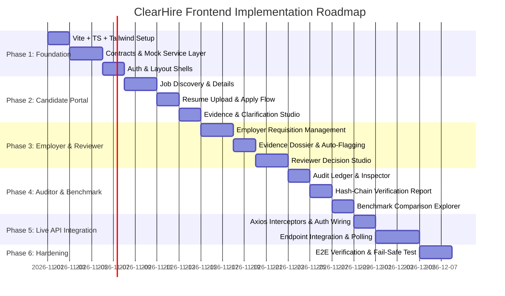

# ClearHire Phased Frontend Implementation Roadmap

> **Document Status:** Complete & Verified  
> **Development Strategy:** UI-First with Mock Adapters -> Full Live API Integration  
> **Target Execution Directory:** `frontend/`  
> **Date of Audit:** October 2026  

---

## 1. Roadmap Overview & Timeline

The ClearHire frontend implementation is structured into 6 sequential phases designed to deliver a working, visually complete evidence transparency interface within 4 weeks (using synthetic mock datasets), followed by live API integration and enterprise hardening.

---

## 2. Phase-by-Phase Breakdown

### Phase 1: Environment Setup, Design System & Auth Shell
- **Duration:** Week 1 (Days 1–7)
- **Goal:** Establish a robust React 18+ TypeScript application shell with a full mock service layer and role-based authentication routing.
- **Dependencies:** None.
- **Deliverables:**
  1. Vite project initialization in `frontend/` with Tailwind CSS and Lucide icons.
  2. TypeScript data contracts in `src/contracts/` strictly reflecting backend schemas.
  3. Mock Service Engine in `src/services/mock/` with realistic fixtures for all 4 roles.
  4. Authentication store (`useAuthStore`) supporting instant role switching for rapid visual testing.
  5. Layout shells: `PublicLayout`, `CandidateLayout`, `EmployerLayout`, `ReviewerLayout`, and `AuditorLayout`.
  6. Functional pages: `/login`, `/register`, `/access-denied`, `/*`.
- **Exit Criteria:** A developer can log in as a Candidate, Employer, Reviewer, or Auditor and see the appropriate navigation shell with simulated session state.

---

### Phase 2: Candidate Portal UI & Evidence Loop
- **Duration:** Week 2 (Days 8–14)
- **Goal:** Deliver the complete candidate journey: discovering jobs, uploading resumes, tracking application progress, and inspecting grounded evidence.
- **Dependencies:** Phase 1 (Layouts and Mock Engine).
- **Deliverables:**
  1. `CandidateDashboardPage` (`/candidate/dashboard`): Active application status cards and notifications.
  2. `CandidateJobsPage` (`/candidate/jobs`): Searchable job catalog with department filters.
  3. `CandidateJobDetailPage` (`/candidate/jobs/:jobId`): Requisition overview and active criteria breakdown.
  4. `ResumeUploadModal` (`M-C1`): Drag-and-drop PDF dropzone with progress bar and simulated text extraction.
  5. `CandidateApplicationDetailPage` (`/candidate/applications/:applicationId`): Factual evidence coverage banner, grounded quotes, and `ClarificationSubmissionModal` (`M-C2`).
  6. `CandidateProfilePage` (`/candidate/profile`): Verified skill tag cloud with source excerpts.
- **Exit Criteria:** Candidate can search jobs, upload a sample resume, view simulated criterion evaluation statuses (`supported`, `ambiguous`, `not_found`), and submit an explanatory clarification.

---

### Phase 3: Employer & Reviewer Portals UI
- **Duration:** Week 3 (Days 15–21)
- **Goal:** Build the employer requisition builder, candidate screening dossier, and reviewer decision studio.
- **Dependencies:** Phase 2 (Evidence presentation components).
- **Deliverables:**
  1. `EmployerDashboardPage` (`/employer/dashboard`): Pipeline statistics and escalation counts.
  2. `EmployerJobsPage` (`/employer/jobs`): Requisitions data table with status filtering.
  3. `EmployerJobCreatePage` (`/employer/jobs/new`): Dynamic criteria editor with weight sliders and required/preferred toggles.
  4. `EmployerJobDetailPage` (`/employer/jobs/:jobId`): Criteria versions view and applicant sub-table.
  5. `EmployerApplicationDetailPage` (`/employer/applications/:applicationId`): Candidate evidence dossier with "Run Evaluation" and "Auto-Flag Review" buttons.
  6. `ReviewerDashboardPage` (`/reviewer/dashboard`): Workload summary and urgency indicators.
  7. `ReviewerQueuePage` (`/reviewer/queue`): Triage queue filtered by status (`pending`, `under_review`, `resolved`).
  8. `ReviewCaseDetailPage` (`/reviewer/cases/:caseId`): Split-screen inspection view with criterion benchmarks, candidate statements, and `ReviewDecisionForm` with mandatory rationale enforcement.
- **Exit Criteria:** Employer can create a requisition, inspect an applicant's evidence, push ambiguous claims to the reviewer queue, and a reviewer can record an accepted/rejected verdict with mandatory rationale.

---

### Phase 4: Auditor Portal, Benchmark & Polish
- **Duration:** Week 4 (Days 22–28)
- **Goal:** Complete compliance verification tools, immutable audit ledger, and the before/after ATS screening benchmark explorer.
- **Dependencies:** Phase 3 (Review decisions and audit events).
- **Deliverables:**
  1. `AuditorChainVerificationPage` (`/auditor/verification`): Formal cryptographic report proving hash-chain continuity from sequence 1 to head.
  2. `AuditorEventsPage` (`/auditor/events`): Searchable audit ledger with SHA256 event hash badges.
  3. `AuditorEventDetailPage` (`/auditor/events/:eventId`): Detailed state delta inspector.
  4. `BenchmarkExplorerPage` (`/benchmark`): Visual benchmark comparing traditional keyword ATS screening against ClearHire evidence matching on the synthetic ground-truth dataset.
  5. Responsive layout testing (desktop, tablet, mobile viewports).
- **Exit Criteria:** Auditor can verify hash-chain integrity, explore audit history, and stakeholders can demonstrate the benchmark report with zero live backend dependency.

---

### Phase 5: Centralized Backend API Client & Live Integration
- **Duration:** Week 5 (Days 29–35)
- **Goal:** Switch the service layer from mock fixtures to live FastAPI endpoints (`http://localhost:8000/api/v1`).
- **Dependencies:** Phases 1–4 UI completeness; running FastAPI backend.
- **Deliverables:**
  1. Centralized Axios client (`src/services/api/client.ts`) with request interceptor injecting JWT bearer tokens and response interceptor handling 401 re-authentication.
  2. Live API adapters implementing contracts:
     - `auth.api.ts` -> `/api/v1/auth/*`
     - `documents.api.ts` -> `/api/v1/documents/*` (with polling for OCR and AI extraction)
     - `jobs.api.ts` -> `/api/v1/jobs/*`
     - `applications.api.ts` -> `/api/v1/applications/*`
     - `evaluations.api.ts` -> `/api/v1/evaluations/*`
     - `reviews.api.ts` -> `/api/v1/review-flags/*`, `/api/v1/reviews/*`
     - `audit.api.ts` -> `/api/v1/audit/*`
     - `benchmark.api.ts` -> `/api/v1/benchmark/*`
  3. Toggle `VITE_USE_MOCK=false` in `.env`.
  4. Live multipart PDF upload streaming and real database persistence.
- **Exit Criteria:** Every page loads and mutates live database state in PostgreSQL without mock fallbacks.

---

### Phase 6: End-to-End Verification, Performance & Hardening
- **Duration:** Week 6 (Days 36–42)
- **Goal:** Full enterprise verification, production bundling, error boundary validation, and documentation handover.
- **Dependencies:** Phase 5 (Live integration).
- **Deliverables:**
  1. Comprehensive end-to-end user flow verification:
     - Candidate registers -> applies with real PDF -> views evidence claims.
     - Employer runs evaluation -> auto-flags ambiguous criteria.
     - Reviewer records decision with rationale -> application marks as reviewed.
     - Auditor checks cryptographic hash chain -> verifies 100% validity.
  2. Error boundary testing (network dropouts, 500 errors, validation failures).
  3. Bundle optimization: Vite code-splitting, lazy page chunking, lighthouse audit score > 90.
  4. Complete developer documentation and deployment guide.
- **Exit Criteria:** Production build passes zero-warning linting, bundle size < 250kB initial load, 100% verified against live backend.

---

## 3. Recommended Implementation Order Summary

To achieve the fastest path to a demonstrated, functional prototype:
1. **Week 1:** Foundation, Types, Mock Engine, Auth & Layouts
2. **Week 2:** Candidate Discovery & Evidence Loop (MVP Pages `C-01`, `C-02`, `C-03`, `C-05`)
3. **Week 3:** Employer Requisitions & Reviewer Studio (MVP Pages `E-01`, `E-02`, `E-03`, `E-04`, `E-06`, `R-01`, `R-02`, `R-03`)
4. **Week 4:** Auditor Hash-Chain Verification (MVP Page `A-04`) & Benchmark Explorer (`B-01`)
5. **Week 5:** Live API Integration with FastAPI backend
6. **Week 6:** Enterprise Hardening & E2E Validation
